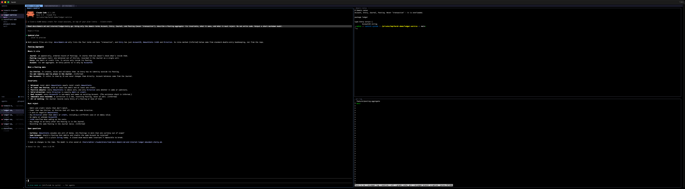
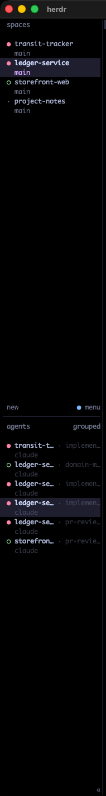
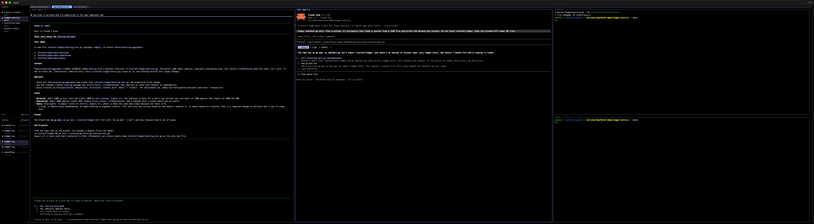
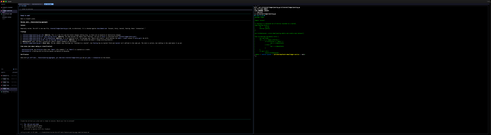
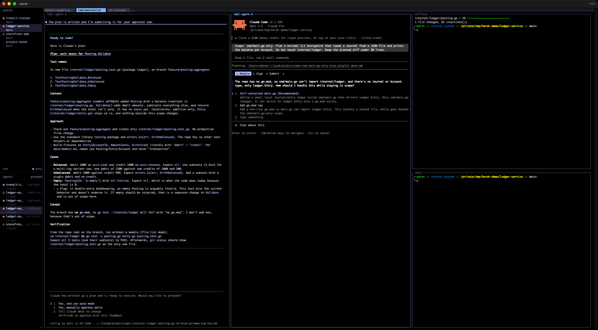
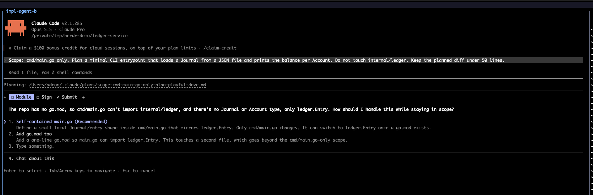

# Herding Agents: How I Actually Use Herdr (on a Ridiculously Wide Screen)

One coding agent is a tool. Two is a pair. Six is a zoo, and somebody has to know which animal is chewing on the fence.

For most of this year that somebody was me, armed with a pile of terminal windows, a couple of tmux sessions I half remembered setting up, and the nagging feeling that some agent somewhere had been politely waiting on a yes/no question for twenty minutes. Agents don't tap you on the shoulder. They sit there, cursor blinking, and burn the most expensive thing in the whole setup, which is wall-clock time.

[Herdr](https://herdr.dev) fixed most of that for me. This post covers what it is, how it works, and how I lay it out day to day. There's a [companion post](./02-why-i-break-it-out-this-way.md) on *why* I split things up the way I do and how I prompt inside the panes. This one is the tour.



## What Herdr is

Herdr bills itself as "the runtime your coding agents live on." Less marketing, more mechanics: it's a **terminal workspace manager built for AI coding agents**. If you've used tmux, you already have about 70% of the mental model. It's:

- **A single Rust binary.** No Electron and no browser tab pretending to be a terminal. `brew install herdr`, or `curl -fsSL https://herdr.dev/install.sh | sh`, and you're done.
- **Something that runs *inside* your terminal.** iTerm, Ghostty, WezTerm, kitty, Alacritty, even inside tmux if you enjoy nesting dolls. It doesn't replace your terminal. It organizes what's in it.
- **A client/server pair.** A background server owns the terminal sessions. The thing you look at is just a client. Close the window, detach, drop SSH, and the agents keep working. Reattach and they're right where you left them. (I learned this the fun way while building the screenshots for this post: the demo window got closed out from under me mid-run, and every agent was still sitting there when I reattached.)
- **Agent-aware.** This is the actual point. Herdr detects Claude Code, Codex, Cursor's agent, Copilot CLI, OpenCode, Devin and a [pile of others](https://herdr.dev/docs/agents/), then classifies each one's state so you don't have to go look.

## The model: session › space › tab › pane

Herdr's [concepts page](https://herdr.dev/docs/concepts/) lays out four nouns. The precision matters, so here they are the way I think about them.

| Noun | What Herdr says it is | What I use it for |
|---|---|---|
| **Session** | A persistent server namespace. `herdr` attaches to the default one; `herdr --session <name>` gives you an isolated one. | My one long-lived "everything" session, plus throwaway named sessions when I'm experimenting (like the demo session for this post's screenshots). |
| **Workspace** (the sidebar calls them *spaces*) | "The top-level project container. Use one workspace per repo, task, or investigation." | **One space per folder I'm working in.** Full stop. |
| **Tab** | "A layout inside a workspace." | **One tab per kind of work:** `pr-reviews`, `domain-modeling`, `implementation`. |
| **Pane** | "A real terminal." | One agent, or one shell, or one thing I'm watching. Arranged in vertical or horizontal splits. |

Then there are the **agent states**, which make the whole thing worth it:

- **Blocked:** the agent needs input, approval, or a decision. *This is the one you care about.*
- **Working:** it's chewing.
- **Done:** it finished and you haven't looked yet.
- **Idle:** it finished and you have looked.
- **Unknown:** Herdr can't tell, usually because it's a plain shell.

Those states roll up into the sidebar. Each space gets a dot, and there's an **agents** list underneath that shows every agent across every space. One glance and I know who's blocked, who's working, and who's done and quietly waiting for me to read their output.



That's the shoulder tap agents never gave me.

## How it works (enough to be dangerous)

### Keyboard

The default prefix is `ctrl+b`, deliberately tmux-flavored, and the keymap is "prefix-first" so Herdr doesn't steal keystrokes from your shell, editor, or the agent. The ones I actually use:

| Keys | Does |
|---|---|
| `prefix` `v` | Split vertical: new pane to the right, side by side |
| `prefix` `-` | Split horizontal: new pane below, stacked |
| `prefix` `h` / `j` / `k` / `l` | Move focus left / down / up / right |
| `prefix` `z` | Zoom the current pane (and again to unzoom) |
| `prefix` `r` | Resize mode |
| `prefix` `c` | New tab |
| `prefix` `shift+t` | Rename tab |
| `prefix` `1`…`9` | Jump to tab N |
| `prefix` `shift+n` | New workspace (space) |
| `prefix` `w` | Workspace picker |
| `prefix` `b` | Toggle the sidebar |
| `prefix` `q` | Detach (everything keeps running) |
| `prefix` `?` | Help, for when you forget all of the above |

Run `herdr --default-config` to see the full annotated config, including how to remap any of it. Mouse works too: click, drag, split. I won't judge.

### The CLI and socket API

Here's where it stops being "tmux with a status light." Everything you can do with a keystroke you can also do from the command line over Herdr's [socket API](https://herdr.dev/docs/socket-api/). That includes the agents themselves, since they're running in panes Herdr owns. Every screenshot in this post came from a layout I scripted like this, in an isolated session so my real one never got touched:

```bash
# a space per folder
herdr workspace create --cwd ~/Codez/ledger-service --label ledger-service

# name the first tab for the kind of work happening in it
herdr tab rename w3:t1 domain-modeling

# agent on the left, reference material on the right, split again downward
herdr pane split w3:p1 --direction right --ratio 0.5
herdr pane split w3:p2 --direction down  --ratio 0.5

# start an agent and hand it a scoped prompt
herdr pane run w3:p1 "claude --permission-mode plan"
herdr agent prompt w3:p1 "Read docs/domain.md and internal/ledger/entry.go. Using only the domain terms Account, Entry, Journal, and Posting (never 'transaction'), describe a Posting aggregate..."

# and then, the good part
herdr agent list      # who is working / blocked / done
herdr agent wait w3:p1 --until blocked --until done   # block until it needs me
herdr pane read w3:p1 # read what it said, without switching to it
```

That's enough rope for agents to spawn panes, prompt *each other*, and notice when a sibling is blocked. I'll admit that's both very cool and the setup for a future post titled something like "How My Agents Unionized."

### Integrations

`herdr integration install claude` (or `codex`, `copilot`, `opencode`, and so on) drops a small hook into each agent so it reports its lifecycle to Herdr directly, rather than Herdr inferring state by watching the screen. `herdr integration status` shows what's wired up. Do this. The state dots get noticeably more accurate.

### The rest of the toolbox

- **Worktrees:** `herdr worktree create` makes a git worktree and opens it as its own space. It fits the one-branch-per-agent pattern I wrote about in [Giving Every Agent Its Own Branch: Git Worktrees for Parallel AI Work](https://compositecode.blog/2026/08/19/worktrees/).
- **Remote machines:** `herdr --remote <ssh-target>` puts panes on other boxes in the same sidebar, and they reconnect independently. See [Connecting machines](https://herdr.dev/docs/connecting-machines/).
- **Session state:** layouts persist and restore. Processes don't survive a server restart (nothing does, that's physics), but the shape of your workspace does. See [Session state](https://herdr.dev/docs/session-state/).

## How I actually use it

That's the brochure. Here's what my screen looks like.

### One space per folder

Every folder I'm actively working in gets its own space, named after the folder. As I type this, my sidebar has ten of them: `interlinedlist`, then `interlinedlist-ios`, `interlinedlist-macos-native`, `interlinedlist-windows-app`, `interlinedlist-android`, `interlinedlist-architecture-migration`, a couple of client and side projects, and the repo this post lives in.

Is that a lot? Sure. Is it more than what's actually in my head? No. It's *exactly* what's in my head, and that's the point. The sidebar is a direct readout of my working memory. If it isn't a folder I'm working in, it doesn't get a space. When I stop working in a folder, the space goes away. My `config.toml` even sorts the agent list by space (`agent_panel_sort = "spaces"`) so the agents group the same way my brain does.

It's mostly for my own mental organization, and I'm fine with that. The agents don't care what the sidebar looks like. I do.

### One tab per kind of work

Inside a space, tabs aren't "more room." Tabs are **modes**. I name them for the kind of work being done:

- **`domain-modeling`**: one agent, plus the glossary, domain notes, and recent history open next to it. The agent's job is to think, not type.
- **`implementation`**: one or more agents, each scoped to a slice of the code, with a diffstat or test runner and a plain shell beside them.
- **`pr-reviews`**: a reviewing agent next to the actual diff, so I can check its claims against the code without switching windows.

Most spaces have just one tab, whichever mode that folder is in today. The busy ones have all three. Switching tabs is switching hats, and the tab label tells me which hat is on before I've read a single line.





### One or more terminals, split vertically or horizontally

Within a tab I keep a simple rule: **agents get tall columns, shells get short stacks.**

Agents produce long, scrolling output: plans, numbered findings, diffs they want to show me. That wants height. So agents get vertical splits (`prefix v`), side by side, full height. Shells, test runners, `git log`, diffstats and log tails are glanceable. They get horizontal splits (`prefix -`) stacked in the right-hand column.

### The ultrawide changes the math

Here's the cheat. I run all of this on a **5120×1440, 32:9 ultrawide**: two 2560×1440 monitors fused into one with no bezel down the middle. At normal terminal font sizes, that's room for **three or four full-height agent columns *plus* a stacked utility column and the sidebar**, all visible at once, nobody squished.

On a regular 16:9 screen, that same implementation tab looks like this:



Workable. Tight. Add a third agent and you're zooming panes in and out all day. On the ultrawide it's this:


The difference isn't really "more stuff." It's that **nothing is hidden**. When an agent goes blocked, I don't need to find it. It's already on screen, in my peripheral vision, with a red dot in the sidebar to back it up. Herdr tells me *who* needs attention. The ultrawide means I can *see* why without changing anything.



That screenshot is an agent I'd told to touch `cmd/main.go` *only*. It found the repo had no `go.mod`, which meant staying in scope required a decision. So it stopped, went **blocked**, and asked. Herdr flagged it, and I could see the question without switching anything. Total cost: one keystroke. The alternative, an agent "helpfully" adding a module file and rewiring imports across a package I'd explicitly fenced off, costs a lot more than one keystroke. Why that worked, and how I write prompts so it keeps working, is [the next post](./02-why-i-break-it-out-this-way.md).

## The short version

- **Herdr** is a terminal workspace manager for coding agents: one Rust binary, runs in your terminal, background server, agent-state detection.
- **Spaces are folders.** One per folder you're working in. It's a mirror of your head, not a filing cabinet.
- **Tabs are modes of work.** `pr-reviews`, `domain-modeling`, `implementation`.
- **Panes:** agents tall, shells short.
- **The sidebar** tells you who's blocked. The **ultrawide** lets you see why without moving.

Install it, run `herdr`, hit `ctrl+b ?`, and give it a day. Worst case, you've got a nice tmux. Best case, you stop finding agents that have been patiently blocked since lunch.

---

### References

- Herdr: [herdr.dev](https://herdr.dev) · [Docs](https://herdr.dev/docs/) · [Concepts](https://herdr.dev/docs/concepts/) · [Configuration & keybindings](https://herdr.dev/docs/configuration/) · [Agents](https://herdr.dev/docs/agents/) · [Socket API](https://herdr.dev/docs/socket-api/) · [Source on GitHub](https://github.com/herdrdev/herdr)
- Related on Composite Code:
  - [Giving Every Agent Its Own Branch: Git Worktrees for Parallel AI Work](https://compositecode.blog/2026/08/19/worktrees/)
  - [Ask, Plan, Confirm: Making Agents Stop Before They Start](https://compositecode.blog/2026/08/20/plan-then-build/)
  - [Twenty-ish Terminal Commands for Getting Around the File System](https://compositecode.blog/2026/09/11/20-terminal-commands/)
- Screenshots were captured on Herdr 0.8.0 in an isolated `--session`, against throwaway demo repos, with Claude Code in plan mode (nothing was written to disk by the agents).
