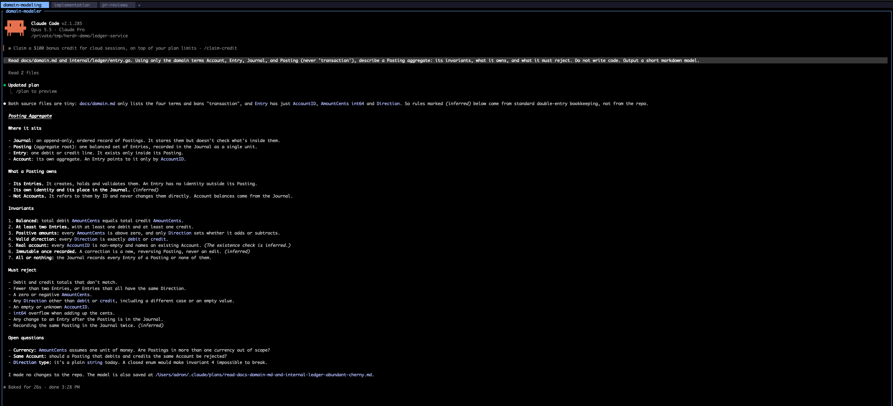
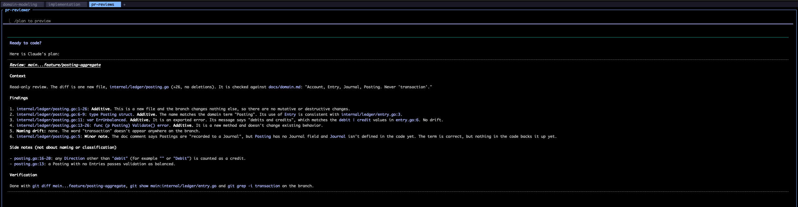
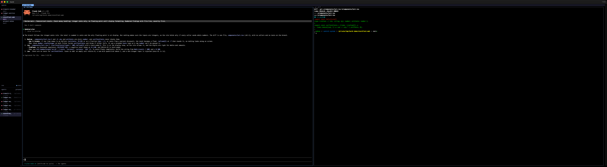

# Spaces, Tabs, Panes, and Precise Words: Why I Break Agent Work Out the Way I Do

In [the previous post](./01-herding-agents-with-herdr.md) I toured [Herdr](https://herdr.dev) and how I lay it out: one space per folder, one tab per kind of work, agents in tall columns, shells in short stacks, all of it spread across a 5120×1440 ultrawide. That's the *what*. This one is the *why*, and then the part that actually decides whether any of it pays off: how I talk to the agents once they're in their panes.

Short version: the layout isn't decoration. It's **context management for two kinds of brains**, mine and the models', and the prompts are the same idea at a smaller scale. Every tool in this stack, Claude Code, Codex, Cursor, and the human, gets worse the more unrelated junk is in its head. So I keep the junk out, structurally first and then verbally.

## Part 1: Why I break it out like this

### Spaces are folders because the folder is the agent's whole world

An agent's working directory isn't a detail. It's the edge of its universe. Whatever it can read, grep, build, and break starts at that folder. So when I make **one space per folder**, I'm not organizing windows. I'm drawing the same boundary the agent already lives inside, and making it visible to me.

That buys three things:

1. **The sidebar is a readout of my working memory.** Ten spaces means ten things in flight. If a folder isn't in the sidebar, I'm not working on it. When I'm done, the space goes away. There's no "misc" space and no "scratch" space, because "misc" is where context goes to die.
2. **Blast radius is legible.** If something is going sideways in `ledger-service`, the dot next to `ledger-service` says so. Nothing in that space can be quietly editing `storefront-web`, because it doesn't live there.
3. **It pairs with worktrees.** When I need two implementation agents on the same repo at once, each gets its own worktree and its own branch, and in Herdr that's just another folder, so another space (`herdr worktree create` does this directly). I made the full case in [Giving Every Agent Its Own Branch: Git Worktrees for Parallel AI Work](https://compositecode.blog/2026/08/19/worktrees/): "Run two coding agents against a single working tree and they will fight." Spaces-as-folders keeps the referee's view honest.

### Tabs are modes because each mode is a different verb

I name tabs `domain-modeling`, `implementation`, and `pr-reviews` because those are three different *jobs*. Each one comes with a different posture from me and a different register of prompt to the agent.

| Tab | The verb | My posture | What the agent is allowed to do |
|---|---|---|---|
| `domain-modeling` | **think** | Skeptical, Socratic | Read, reason, write a model. No code. Plan mode. |
| `implementation` | **change** | Directive, fenced | Edit inside an explicit scope, after an approved plan |
| `pr-reviews` | **judge** | Adversarial, evidentiary | Read the diff, report findings. No fixing. |

The failure mode I'm designing against is **verb drift**. You start a conversation reviewing a PR, you say "huh, good catch," and three messages later the "reviewer" is rewriting the module, now with the confidence of something that just graded its own homework. Separate tabs, and separate agent sessions in them, make the verb change explicit. If I want a fix, I go to the implementation tab and ask for one there, with a scope. It's the same rule I put on the read-only reviewer agents in [Ask, Plan, Confirm: Making Agents Stop Before They Start](https://compositecode.blog/2026/08/20/plan-then-build/): the reviewer doesn't get to "slide from 'here is a finding' into 'and I fixed it' without crossing the same line everyone else crosses." The tab is that line, drawn on screen.

There's a human benefit too. When I switch to a tab named `pr-reviews`, my brain switches hats before I've read a word. Mode labels are cheap and they work.

### A pane is one agent, one context window, one job

Every agent pane gets **one job for the life of that conversation**. When the job is done, the conversation ends, and the next job gets a fresh agent. Context windows are big now, but they aren't free and they aren't clean. Every stale plan, abandoned approach, and "actually, ignore that" sits in there and pulls on the next answer. A pane per job is the cheapest context hygiene there is.

The panes *next* to an agent are there for **verification, not decoration**:

- In `domain-modeling`, the glossary and domain notes sit beside the agent, so I can check that it's using the words we agreed on.
- In `implementation`, a diffstat and a shell sit beside the agents, so I can see what *actually* changed, not what the agent says changed.
- In `pr-reviews`, the raw diff sits beside the reviewer, so every `file:line` it cites can be checked by moving my eyes and nothing else.


Trust, but keep the evidence in the same field of view.

### Tall for agents, short for shells, and why 32:9 matters

Agents emit long, structured output (plans, findings, tables), so they get full-height vertical splits. Shells and watchers are glanceable, so they get short horizontal stacks in a utility column. That isn't a style choice. It's matching pane shape to how much reading each pane needs.

The ultrawide makes it work without compromise. At 5120×1440 I get three or four full-height agent columns *and* the utility column *and* the sidebar, with nothing hidden behind a zoom or another tab. That matters for one reason above all: **a blocked agent is a cost that accrues silently.** Herdr's sidebar tells me *that* something is blocked. Having it physically on screen tells me *why*, in peripheral vision, without moving. The less effort it takes to notice, the shorter the stall.

## Part 2: Keeping Claude, Codex, and Cursor effective and accurate

All of the above is plumbing. The water is language.

I've been on this soapbox a while. In [Precision in Words, Precision in Code: The Power of Writing in Modern Development](https://compositecode.blog/2024/12/09/precision-in-words-precision-in-code-the-power-of-writing-in-modern-development/) I argued that "Writing isn't just 'extra work'—it's the work that clarifies, simplifies, and accelerates everything else," and in [AI Prompt Engineering: Mastering Language Constructs](https://compositecode.blog/2025/02/25/ai-prompt-engineering-mastering-language-constructs/) I went into how the actual constructs, imperatives, conditionals, and contextual markers, shape what comes back. With agents that act, not just answer, the stakes go up. A vague word in a chat gets you a vague paragraph. A vague word in an agent prompt gets you a nine-file diff.

Here's what I actually do. Every example below is a real prompt and a real response, captured for the screenshots in this repo with Claude Code in plan mode against throwaway demo projects.

### 1. Use the domain's words, and ban the overloaded ones

Accurate language starts with **the same word meaning the same thing every time**: in the docs, in the code, in the prompt, in the review. That's just [ubiquitous language](https://martinfowler.com/bliki/UbiquitousLanguage.html) from domain-driven design, and agents need it more than humans do, because they fill every gap with the most *statistically likely* meaning, which is rarely *your* meaning.

So I keep a glossary in the notes repo (more on that in [Notes Repos as Shared Project Context](https://compositecode.blog/2026/09/25/notes-repos-as-shared-project-context/), where the glossary is described as "cheap insurance against confident mistakes"), and I put the words *in the prompt*, including the ones that are off limits:

> Read docs/domain.md and internal/ledger/entry.go. Using only the domain terms **Account, Entry, Journal, and Posting (never 'transaction')**, describe a Posting aggregate: its invariants, what it owns, and what it must reject. Do not write code. Output a short markdown model.

"Transaction" is banned because in a ledger it's hopelessly overloaded: a database transaction, a business event, a bank-statement line. Pick one meaning, give it its own word, and forbid the ambiguous one. Here's what came back:



Two things to notice. The model sticks to Account, Entry, Journal, Posting the whole way through. And it **marks which rules it inferred** from general double-entry practice versus which came from the repo: "Rules marked *(inferred)* come from standard double-entry practice, not the repo." That distinction is gold in domain modeling, and it showed up because the prompt was explicit about *where the truth lives* (those two files).

### 2. Lead with scope, as the first word

My implementation prompts literally start with the word `Scope:`.

> **Scope: cmd/main.go only.** Plan a minimal CLI entrypoint that loads a Journal from a JSON file and prints the balance per Account. **Do not touch internal/ledger.** Keep the planned diff **under 50 lines**.

Scope first, because everything after it gets read in its light. Then a positive fence (only this file), a negative fence (not that package), and a size limit stated as a number, not a vibe. "Keep it small" means nothing. "Under 50 lines" is checkable. I went deeper on why scope and diff size are the main levers in [Hurting or Helping Devs?](https://compositecode.blog/2026/04/15/hurting-or-helping-devs/).

The payoff:


The repo had no `go.mod`, so `cmd/main.go` *couldn't* import `internal/ledger`. An unfenced agent "fixes" that by adding a module file, rewiring imports, and maybe stubbing a Journal type in the package I'd fenced off. This one **stopped and asked**, offered the in-scope option as the recommendation, and named the out-of-scope option *as* out of scope: "This touches a second file, which goes beyond the cmd/main.go-only scope." Herdr flagged it blocked, and I could see it on the ultrawide without switching anything. That's the whole system working: precise words create the stop, and the layout makes the stop cheap.

### 3. Pick verbs that mean exactly one thing

`plan`, `implement`, `review`, and `fix` are different verbs, and I never let one stand in for another.

- **Plan** means produce a plan and change nothing. I back it with tooling: agents start in plan mode (`claude --permission-mode plan`; Codex and Cursor have their own read-only and ask-first modes), so the verb and the permission agree.
- **Implement** means change things inside the approved plan's scope, and only after an explicit yes. Approval is scoped to the plan that was approved. This is the three-beat gate from [Ask, Plan, Confirm](https://compositecode.blog/2026/08/20/plan-then-build/).
- **Review** means read and report. It doesn't mean fix.
- **Fix** means a new implementation task, with its own scope, in the implementation tab.

When the verb is precise, the agent's job is precise, and so is my evaluation of whether it did the job.

### 4. Specify the shape of the answer

If I can't check an answer quickly, I'll check it badly. So I specify the output format in a way that's easy to verify against the pane next door:

> Review the diff main...feature/posting-aggregate. **Classify every change as additive, mutative, or destructive.** Flag any naming that drifts from docs/domain.md. Report findings as a **numbered list with file:line**. Do not propose rewrites outside the diff.

"Additive, mutative, or destructive" isn't decoration either. It's the vocabulary from [Additive vs. Mutative vs. Destructive Code Changes (and Why AI Agents Love the Wrong One at 2:13AM)](https://compositecode.blog/2026/02/12/additive-vs-mutative-vs-destructive-code-changes-and-why-ai-agents-love-the-wrong-one-at-213am/), and giving the reviewer that vocabulary makes it classify instead of just commenting.



And because the question was precise, the reviewer had attention left over for what mattered. Under "side notes" it flagged that **any `Direction` other than the exact string `"debit"`, including `""` or `"Debit"`, gets counted as a credit**, and that **an empty Posting passes validation as balanced**. Neither is a naming issue. Both are exactly the kind of quiet behavioral drift that post warned about: code that looks right and behaves like an alien artifact. A vague "please review this PR" tends to bury that under eleven style nits.

The same pattern works for any review lens. On the storefront demo, "integer cents only, no floating point until display formatting. Numbered findings with file:line, **severity first**" produced a short, ranked list I could verify in about thirty seconds.



### 5. Front-load the context instead of looping for it

A thin prompt plus five rounds of correction is worse than one well-fed prompt, and more expensive. I made that argument at length in ["Loop Engineering" Is Mostly Just Broken SDLC Wearing a Costume](https://compositecode.blog/2026/07/15/loop-engineering-is-mostly-just-broken-sdlc-wearing-a-costume/): "A well-fed single pass beats a starved five-pass loop most of the time." In practice that means every prompt names **where the truth lives**: the files to read, the glossary, the plan in the notes repo, the decision that was already made and shouldn't be re-litigated.

It also means the *environment* has to be ready. An agent that can't build, test, or reach the systems it needs will improvise, and improvisation is the opposite of accuracy. The checklist I use for that is in [Agent-Ready Local Environments and MCP](https://compositecode.blog/2026/09/24/agent-ready-local-environments-and-mcp/): "An agent with broad access and no rules will eventually do something technically impressive and socially awful."

### 6. Same template, any agent

Claude Code, Codex, and Cursor have different personalities and different defaults, but the prompt *shape* carries across them. Herdr doesn't care which one is in a pane. It detects them all, so I can put a different tool in the reviewer pane than the one that wrote the code. A second model has different blind spots, and that's the point of a second opinion. The template:

```text
Scope: <path(s)> only. <Do not touch: path(s)>.
Context: Read <files / glossary / plan>. Use the terms <A, B, C>; never <overloaded term>.
Task (<verb: plan | implement | review>): <one sentence, one job>.
Constraints: <additive only | under N lines | no new dependencies | tests first>.
Output: <numbered list | file:line | severity first | markdown model | test names first>.
If anything above is ambiguous or blocks you, stop and ask.
```

That last line matters most. It turns "the agent is stuck" from a silent failure into a **blocked** state, which Herdr turns into a dot I can see from across the room.

### 7. When an agent goes blocked or done

The loop on my side is short and boring, on purpose:

1. **Blocked:** read the question in place (it's already on screen), answer it, and if the answer is a *decision*, write it into the notes repo's decisions file so the next session doesn't ask again.
2. **Done:** read the output against the evidence pane next to it. If it's a plan, approve it or correct it. If it's findings, open a scoped implementation task in the other tab for anything worth fixing.
3. **Finished job:** end that agent's conversation. New job, new agent, clean context.

## The point of all of it

The spaces, tabs, panes, and ultrawide exist to keep **context small, boundaries visible, and stalls cheap**. The prompting exists to keep **meaning precise**. Neither works without the other. A gorgeous Herdr layout full of agents with vague instructions is just a very wide way to watch things go wrong in parallel, and the most precise prompt in the world doesn't help if the agent has been blocked on it since lunch and you never noticed.

Draw the boundaries on screen. Draw them again in words. Then let the agents work.

---

### References

**Herdr**
- [herdr.dev](https://herdr.dev) · [Docs](https://herdr.dev/docs/) · [Concepts](https://herdr.dev/docs/concepts/) · [Agents](https://herdr.dev/docs/agents/) · [Socket API](https://herdr.dev/docs/socket-api/) · [GitHub](https://github.com/herdrdev/herdr)

**Previously on Composite Code**
- [Precision in Words, Precision in Code: The Power of Writing in Modern Development](https://compositecode.blog/2024/12/09/precision-in-words-precision-in-code-the-power-of-writing-in-modern-development/) (Dec 2024)
- [AI Prompt Engineering: Mastering Language Constructs](https://compositecode.blog/2025/02/25/ai-prompt-engineering-mastering-language-constructs/) (Feb 2025)
- [Architects Evolving: How AI Is Reshaping the Role](https://compositecode.blog/2025/11/04/architects-evolving-with-ai/) (Nov 2025)
- [AI Is Forcing Docs To Finally Grow Up](https://compositecode.blog/2025/12/04/ai-is-forcing-docs-to-grow-up/) (Dec 2025)
- [Additive vs. Mutative vs. Destructive Code Changes (and Why AI Agents Love the Wrong One at 2:13AM)](https://compositecode.blog/2026/02/12/additive-vs-mutative-vs-destructive-code-changes-and-why-ai-agents-love-the-wrong-one-at-213am/) (Feb 2026)
- [Hurting or Helping Devs?](https://compositecode.blog/2026/04/15/hurting-or-helping-devs/) (Apr 2026)
- [The Gap Is Widening and It's Not Slowing Down](https://compositecode.blog/2026/05/26/the-gap-is-widening-and-its-not-slowing-down/) (May 2026)
- ["Loop Engineering" Is Mostly Just Broken SDLC Wearing a Costume](https://compositecode.blog/2026/07/15/loop-engineering-is-mostly-just-broken-sdlc-wearing-a-costume/) (Jul 2026)
- [Giving Every Agent Its Own Branch: Git Worktrees for Parallel AI Work](https://compositecode.blog/2026/08/19/worktrees/) (Aug 2026)
- [Ask, Plan, Confirm: Making Agents Stop Before They Start](https://compositecode.blog/2026/08/20/plan-then-build/) (Aug 2026)
- [Agent-Ready Local Environments and MCP](https://compositecode.blog/2026/09/24/agent-ready-local-environments-and-mcp/) (Sep 2026)
- [Notes Repos as Shared Project Context](https://compositecode.blog/2026/09/25/notes-repos-as-shared-project-context/) (Sep 2026)

**Elsewhere**
- Martin Fowler, [Ubiquitous Language](https://martinfowler.com/bliki/UbiquitousLanguage.html)
